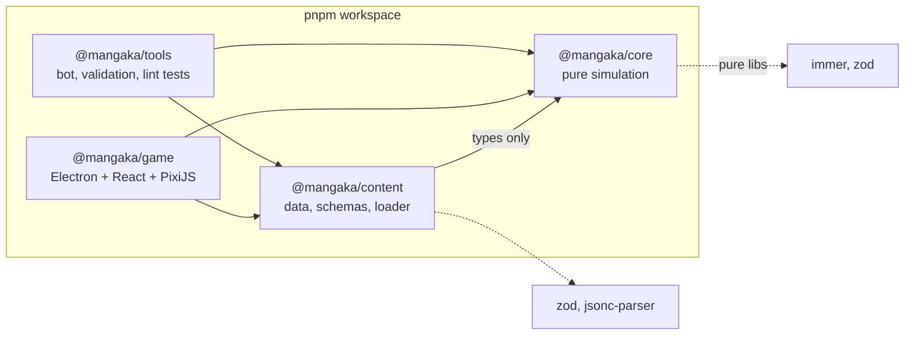
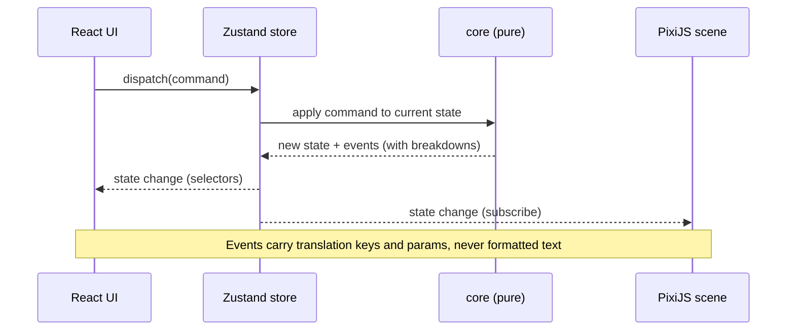
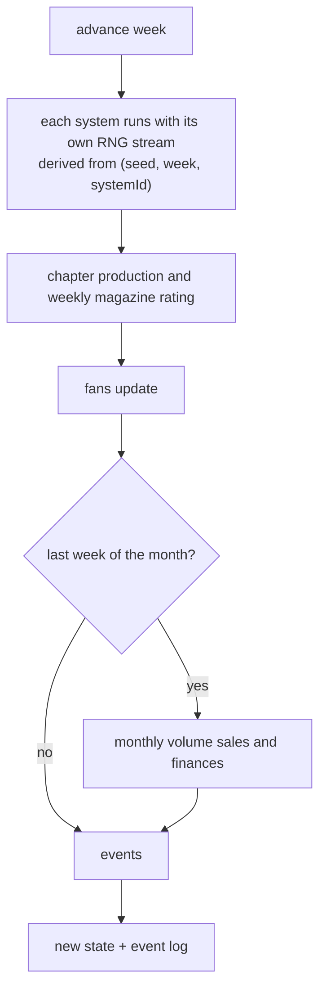
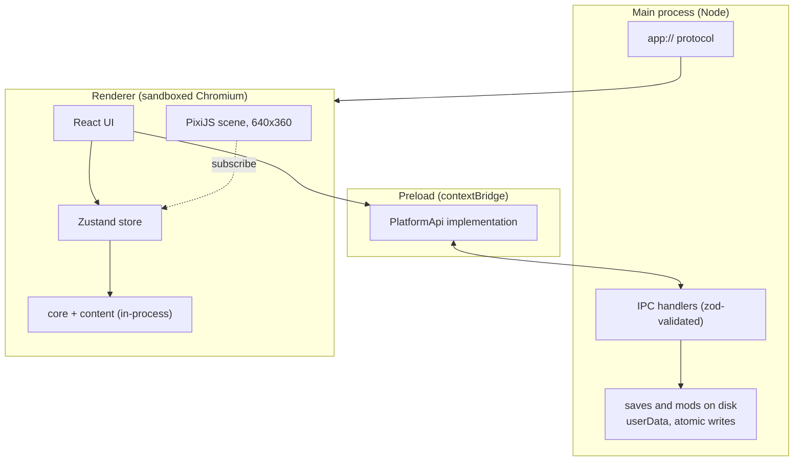
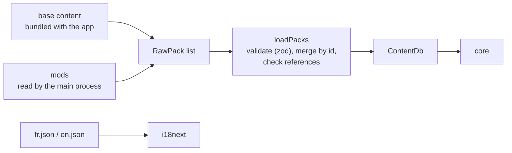

# Architecture

Overview of how Mangaka Tycoon is built. Rules and vision are in [`AGENTS.md`](../AGENTS.md); the reasons behind each choice are in the [ADRs](adr/README.md).
This document summarises and links; it does not introduce decisions.

> Status legend: **built** exists in the repository today, **planned** is decided but not written yet.
> API names in diagrams are illustrative and are finalised in milestone M1.

## 1. Principles

1. The simulation core is **pure**: same state, same command, same seed give the same result ([ADR 0005](adr/0005-prng-sfc32-derived-streams.md)).
2. The UI **never mutates state**: it sends typed commands, the core validates and applies them, and returns events.
3. Content is **data** loaded through one pipeline for base game and mods ([ADR 0002](adr/0002-jsonc-content-format.md), [0003](adr/0003-package-dependency-direction.md)).
4. The renderer reaches the machine only through a narrow, typed `PlatformApi` ([ADR 0008](adr/0008-platform-api.md)).
5. Every rule above is enforced by tooling, not by good intentions (section 6).

## 2. Packages and dependency direction

| Package            | Status  | Role                                                                              |
| ------------------ | ------- | --------------------------------------------------------------------------------- |
| `@mangaka/core`    | planned | `GameState`, calendar, RNG, commands, systems, selectors, saves. No host access.  |
| `@mangaka/content` | planned | JSONC data, zod schemas, `loadPacks`, mod merging, locales.                       |
| `@mangaka/game`    | planned | Electron main and preload, React UI, Zustand store, PixiJS scene.                 |
| `@mangaka/tools`   | built   | Developer scripts. Today: the lint rule tests. Later: simulation bot, validation. |

`core` defines the types it consumes (`ContentDb`, `Balance`); `content` imports them as types only. The domain never depends on the file format.

## 3. From command to event

- Commands and events are discriminated unions (`kind`), handled with exhaustive `switch`.
- Every rating, sales or fans computation returns a **breakdown** so the UI can explain the result.
- The scene only displays; it never calls the core.

## 4. The weekly tick

One tick is one week. The calendar has 4 weeks per month and 48 per year, starting January 1980 ([ADR 0012](adr/0012-calendar-48-weeks.md)).

The loop mirrors the validated core loop of `AGENTS.md` section 2. **The order of systems and the exact formulas are not decided**: they belong to Hugo and are set in milestone M3.
Open design questions are tracked in [`PROGRESS.md`](PROGRESS.md).

## 5. Runtime layers (Electron)

- `contextIsolation: true`, `nodeIntegration: false`, `sandbox` on, strict CSP ([ADR 0009](adr/0009-electron-runtime-and-security.md)).
- The simulation runs in the renderer process, in memory. The host only stores and loads bytes.
- Rendering uses a 640x360 internal resolution, integer scaling only, borderless fullscreen by default ([ADR 0010](adr/0010-pixel-rendering-and-scaling.md)).
- The scene is driven imperatively, without `@pixi/react` ([ADR 0014](adr/0014-pixi-imperative-scene.md)).
- Build tooling: `electron-vite` kept as a thin layer with a documented exit plan, and `electron-builder` for packaging ([ADR 0011](adr/0011-electron-vite-and-exit-strategy.md)).

## 6. Content and saves

A save is a JSON envelope: `{ format, saveVersion, gameVersion, mods, state }`. Loading validates it with zod, runs pure migrations up to the current version,
and refuses cleanly if a mod id used by the save is missing. The save stores the seed, not generator state, because RNG streams are derived ([ADR 0005](adr/0005-prng-sfc32-derived-streams.md)).
The save timestamp is set by the main process, never by the core.

## 7. How the rules are enforced

| Rule                                         | Mechanism                                                                                                     |
| -------------------------------------------- | ------------------------------------------------------------------------------------------------------------- |
| A package only imports what it declares      | pnpm strict `node_modules` layout                                                                             |
| No deep imports between packages             | `exports: { ".": ... }` in `package.json`                                                                     |
| `core` and `content` have no DOM or Node     | `lib: ["ES2023"]`, `types: []` in their `tsconfig`                                                            |
| No clock, entropy, host or classes in `core` | ESLint `no-restricted-*` rules                                                                                |
| Only allowed libraries per package           | `eslint-plugin-boundaries` allow-list (`eslint/boundaries.js`)                                                |
| The rules above really fail when violated    | `tools/src/lint-rules.test.ts`                                                                                |
| Strict typing, no `any` / `as` / `!`         | `strict` TypeScript 6.0 and `typescript-eslint` strict                                                        |
| Quality gate                                 | Husky pre-commit, then CI on Ubuntu and Windows                                                               |
| Supply chain                                 | 3-day release age, build scripts allow-list, SHA-pinned actions ([ADR 0013](adr/0013-supply-chain-policy.md)) |

## 8. Where to find things

- Vision, scope, rules: [`AGENTS.md`](../AGENTS.md).
- Decisions: [`docs/adr/`](adr/README.md).
- Current state and next step: [`docs/PROGRESS.md`](PROGRESS.md).
- Cursor rules by domain: `.cursor/rules/`.
